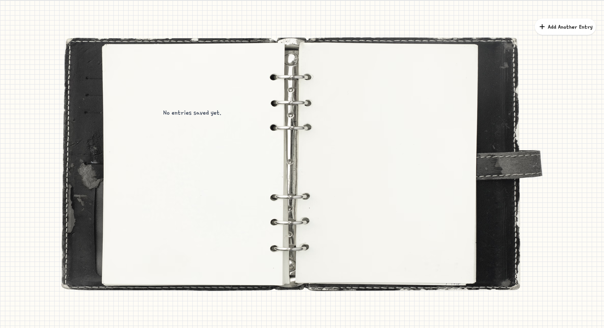
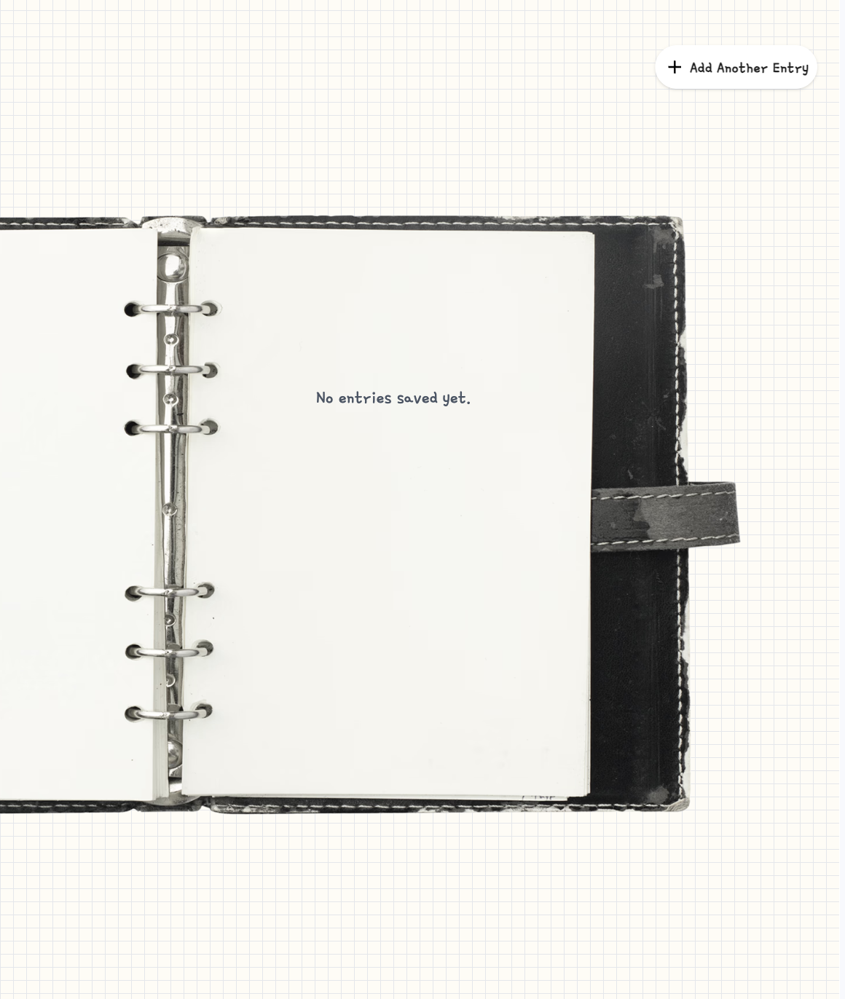
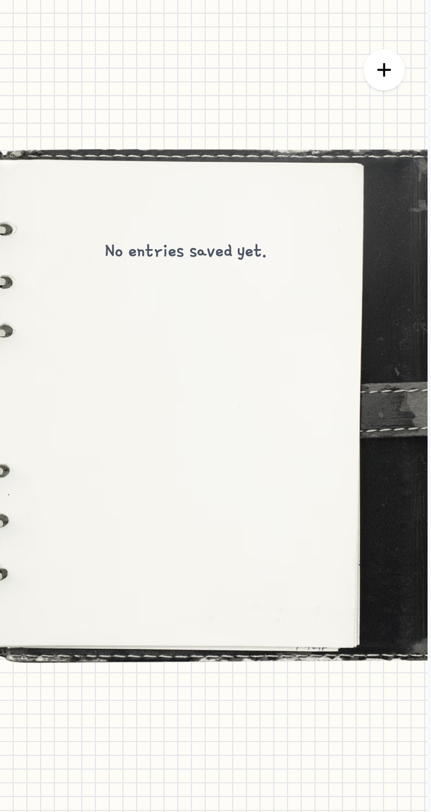

# Feelings Journal 🌿

A calm and personal journaling web application that lets you capture how you feel, reflect on your day, and revisit past entries whenever you need a moment of reflection. Front-end web application built with vanilla JavaScript components. It provides a soft, reflective space where users can select an emotion, write about their day, and save entries that persist in the browser using `localStorage`. The app is fully responsive and offers different layouts for desktop and mobile.
<br>

<p float="left" >
  <video src="https://github.com/user-attachments/assets/a1b2c3d4-e5f6-7890-abcd-ef1234567890" controls width="800" height="400"></video>
  &nbsp;&nbsp;&nbsp;&nbsp;
   <video src="https://github.com/user-attachments/assets/b2c3d4e5-f6a7-8901-bcde-f12345678901" controls width="200" height="400"></video>
</p>

<br>

## Features

- Three distinct screens with smooth transitions
- Emotion selection with colorful character buttons
- Form validation (emotion + title + thoughts required before saving)
- Entries saved to browser `localStorage`
- Responsive design for desktop, tablet, and mobile
- Realistic “page turn” sound when navigating journal pages
- Support for long entries with smooth scrolling
- Thoughtful empty state design when no entries exist
- Built entirely with reusable JavaScript components
<br>

## Screens

#### 1. Welcome / Loading Screen
A soft, animated introduction that sets the calm tone of the app.  
Clicking **Add New Entry** takes you to the form.
<br>

#### 2. Entry Form Screen
- Select how you’re feeling using the emotion buttons
- Give your entry a title
- Write about what influenced your feelings
- The **Save** button only works when all required fields are filled (emotion selected, title entered, and text written)
- Background color changes based on the selected emotion
<br>

#### 3. Journal Entries Screen
- Displays your saved entries in a realistic open journal layout
- **Desktop / Tablet**: Two entries side-by-side with page navigation
- **Mobile**: One entry at a time with previous/next controls
- Long entries can be scrolled to read the full content
- “Turn page” sound plays when navigating between pages
- Special design for when no entries have been saved yet
<br>

## Empty State Design

When no entries have been saved yet, the journal shows a calm empty state on all screen sizes:

| Desktop | Tablet | Mobile |
|---------|--------|--------|
|  |  |  |

*(Replace the image paths above with your actual screenshots)*

<br>

## Built With

- **HTML5**
- **JavaScript** (vanilla) – component-based architecture
- **Tailwind CSS**
- **Vite**
- **Browser localStorage**
- Custom page-turn sound effect

<br>

## Architecture Highlights

The application is built using reusable JavaScript components/screens:

- `LoadingScreen`
- `EntryFormScreen`
- `journalEntriesScreen` (with separate mobile & desktop layouts)
- Form handling and validation logic
- Page navigation system with sound
- `localStorage` utility functions for saving, retrieving, and deleting entries

Screen transitions and background color changes are handled smoothly when moving between views.

<br>

## Data Persistence

All journal entries are stored in the browser’s `localStorage`.

Each entry is saved as an object containing:
- Unique ID
- Emotion + emotion image
- Color
- Title
- Thoughts / reflection
- Timestamp

Entries persist even after closing the browser (on the same device).

<br>

## Project Structure

```text
feelings-journal/
├── public/
├── assets/
├── images/
├── src/
│   ├── animations/
│   ├── click events/
│   ├── components/
│   ├── screens/
│   ├── sounds/
│   ├── utils/
│   ├── main.js
│   └── style.css
├── index.html
├── package.json
└── README.md
```

<br>

## Design & Inspiration

The design and concept of this project were inspired by the **Daily Feelings** project by **Btelgeuse**:

> Inspired by [Btelgeuse/APP---Daily-Feelings](https://github.com/Btelgeuse/APP---Daily-Feelings).

The project was used as inspiration for the overall feelings-journal concept and visual direction, including the use of imagery.

All original code and implementation for **Feelings Journal** is my own work.
Credit and thanks to **Btelgeuse** for the original inspiration

<br>

### Running the Project Locally

Clone the repository:
```bash
git clone https://github.com/yarlinlynn/feelings-journal.git
```

Navigate into the project:
```bash
cd feelings-journal
```

Install dependencies:
```bash
npm install
```

Start the development server:
```bash
npm run dev
```
<br>

### License

This project is open-source and free to use.